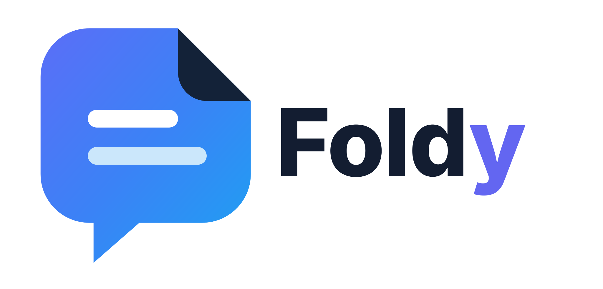

<p align="center">
  
</p>

<h1 align="center">Foldy v4.2.5 — Universal Smart Folders & Chat Manager for Gemini, ChatGPT, Claude, DeepSeek & OpenCode</h1>

<p align="center">
  <a href="#-english">🇺🇸 English</a> · <a href="#-español">🇪🇸 Español</a> · <a href="https://dsaez27.github.io/Foldy/">🌐 Website</a> · <a href="https://github.com/dsaez27/Foldy-agy">⚡ Antigravity CLI Plugin</a>
</p>

---

## 🇺🇸 English

**Foldy** is a universal browser extension (Manifest V3) for **Chrome, Edge, Brave, Opera, Firefox, and Safari** that upgrades your workflow across **Google Gemini**, **OpenAI ChatGPT**, **Anthropic Claude**, **DeepSeek**, and **OpenCode**. It adds smart folders with keyword auto-classification, automatic cloud synchronization, a 1-click Quick Prompt Vault, a control popup with platform statistics, keyboard shortcuts, a collapsible floating toolbar, instant search, chat lock protection, hide/unhide chats, range multi-selection (`Shift + Click`), safe bulk deletion, Markdown export, and JSON backup/restore.

### ✨ Highlights

- 🎨 **10-Preset Visual Theme Engine & Scrollable Theme List**: Switch live between `Adaptive`, `Neo-Brutal`, `Terminal`, `Minimal Flat`, `Neon Synth`, `Nord Frost`, `Catppuccin`, `Warm Paper`, `Solar Amber`, and `Forest Moss` across light and dark host themes.
- ☁️ **Unified Cross-Platform Sync**: Folders, auto-rules, Prompt Vault, language, and visual theme sync automatically across Gemini, ChatGPT, Claude, DeepSeek, and OpenCode tabs (and across PCs via browser cloud sync).
- 🔗 **Cross-Browser Sync Code (`foldy1:`)**: Copy & Apply your Sync Code in seconds to move your setup between Chrome, Edge, Brave, Opera, and Firefox.
- 🧲 **Native Drag & Drop + 5s Undo**: Drag chat rows directly onto folder pills with dropzone highlight and a 5-second Undo toast with animated countdown bar.
- 🔎 **Instant Global Search**: Real-time filtering without debounce (`Escape` to clear) alongside folder, lock, and hidden filters.
- 👁️ **Hide / Unhide Conversations**: Keep your sidebar clean by hiding selected chats without deleting them, and view or restore them anytime from the **Hidden** filter.
- 🧩 **Dynamic Prompt Variables (`{{var}}`)**: Automatically detects `{{variable}}` placeholders in the Prompt Vault and opens a quick-fill modal before inserting into the chat.
- 🎨 **Per-Platform Adaptive Identity**: Automatically adapts accent colors, radii, surface warmth, font stacks, and the Foldy logo to **Gemini**, **ChatGPT**, **Claude**, **DeepSeek**, and **OpenCode**.
- 🧩 **Clean Sidebar Rows & Compact Contextual Dock**: Reclaims title space with a folder accent bar, expandable micro-dot pill, progressive hover/selection checkboxes, and an optional icon-only compact toolbar.
- 🔒 **Lock Protection & Safe Bulk Deletion**: Protect important conversations with a lock badge (`🔒`), select ranges with `Shift + Click`, auto-load history in the background, and safely bulk-delete unlocked chats.
- 🎛️ **Control Popup & Shortcuts**: Live platform counters, instant English/Spanish switcher, direct JSON backup/import, and keyboard shortcuts (`Alt+Shift+F` to toggle panel, `Alt+Shift+S` to focus search).

### ⚡ Also Available for Google Antigravity CLI (`Foldy-agy`)

Using **Google Antigravity CLI (`agy`)**? Install the official native **`/foldy`** plugin ([dsaez27/Foldy-agy](https://github.com/dsaez27/Foldy-agy)) to get smart folders, auto-classification hooks, interactive multi-select (`↑`/`↓` + `Space`), Quick Prompt Vault (`{{var}}`), chat lock protection (`🔒`), Markdown export, and **full `foldy1:` Sync Code compatibility** with this browser extension:

```bash
agy plugin install https://github.com/dsaez27/Foldy-agy
```

---

## 🇪🇸 Español

**Foldy** es una extensión universal de navegador (Manifest V3) para **Chrome, Edge, Brave, Opera, Firefox y Safari** que transforma tu experiencia en **Google Gemini**, **OpenAI ChatGPT**, **Anthropic Claude**, **DeepSeek** y **OpenCode**: añade carpetas inteligentes con clasificación automática por palabras clave, sincronización automática en la nube, bóveda de Prompts rápidos en 1 clic, popup de control con estadísticas por plataforma, atajos de teclado, barra de acciones contraíble, búsqueda instantánea, protección de chats con candado, ocultar/mostrar chats, selección múltiple por rango (`Shift + Clic`), borrado masivo seguro, exportación a Markdown y respaldo/importación en JSON.

### ✨ Características Destacadas

- 🎨 **Motor de 10 Estilos Visuales en Lista Desplazable**: Cambia en vivo entre `Adaptativo`, `Neo-Brutal`, `Terminal`, `Minimal Flat`, `Neon Synth`, `Nord Frost`, `Catppuccin`, `Papel Cálido`, `Ámbar Solar` y `Bosque` en modo claro y oscuro.
- ☁️ **Sincronización Unificada Multi-Plataforma**: Carpetas, auto-reglas, Bóveda de Prompts, idioma y tema visual se sincronizan automáticamente entre Gemini, ChatGPT, Claude, DeepSeek y OpenCode (y entre PCs vía sincronización del navegador).
- 🔗 **Sync Code entre Navegadores (`foldy1:`)**: Copia y aplica tu Sync Code desde el popup para llevar tu configuración entre Chrome, Edge, Brave, Opera y Firefox en segundos.
- 🧲 **Drag & Drop Nativo + Deshacer en 5s**: Arrastra conversaciones directamente sobre las píldoras de carpetas con resaltado de zona de caída y toast **Deshacer** de 5 segundos.
- 🔎 **Búsqueda Global Instantánea**: Filtrado en tiempo real sin retardo (`Escape` para limpiar), combinado con filtros de carpeta, candado y ocultos.
- 👁️ **Ocultar / Mostrar Conversaciones**: Mantén limpia tu barra lateral ocultando chats sin borrarlos y recupéralos cuando quieras desde el filtro **Ocultos**.
- 🧩 **Variables Dinámicas en Prompts (`{{var}}`)**: Detecta automáticamente placeholders `{{variable}}` en la Bóveda de Prompts y abre un modal rápido antes de insertar.
- 🎨 **Identidad Adaptativa por Plataforma**: Adapta automáticamente acentos, radios, calidez de superficie, tipografía y logo a **Gemini**, **ChatGPT**, **Claude**, **DeepSeek** y **OpenCode**.
- 🧩 **Filas Despejadas y Barra Contextual Compacta**: Libera ancho para los títulos con barra lateral de carpeta, micro-punto expansible, checkboxes progresivos y modo compacto opcional solo íconos.
- 🔒 **Protección con Candado y Borrado Masivo Seguro**: Protege conversaciones críticas con candado (`🔒`), selecciona rangos con `Shift + Clic`, carga el historial en segundo plano y elimina en lote de forma segura.
- 🎛️ **Popup de Control y Atajos**: Métricas en vivo por plataforma, selector instantáneo Español/Inglés, respaldo e importación JSON directa y atajos de teclado (`Alt+Shift+F` para mostrar/ocultar panel, `Alt+Shift+S` para buscar).

### ⚡ También disponible para Google Antigravity CLI (`Foldy-agy`)

¿Usas **Google Antigravity CLI (`agy`)**? Instala el plugin nativo **`/foldy`** ([dsaez27/Foldy-agy](https://github.com/dsaez27/Foldy-agy)) para llevar tus carpetas inteligentes, hooks de auto-clasificación, selector interactivo (`↑`/`↓` + `Espacio`), Bóveda de Prompts (`{{var}}`), candados (`🔒`), exportación a Markdown y **sincronización directa con Sync Code `foldy1:`** entre el navegador y la terminal:

```bash
agy plugin install https://github.com/dsaez27/Foldy-agy
```

---

<p align="center">
  © 2026 Foldy · All rights reserved.
</p>
